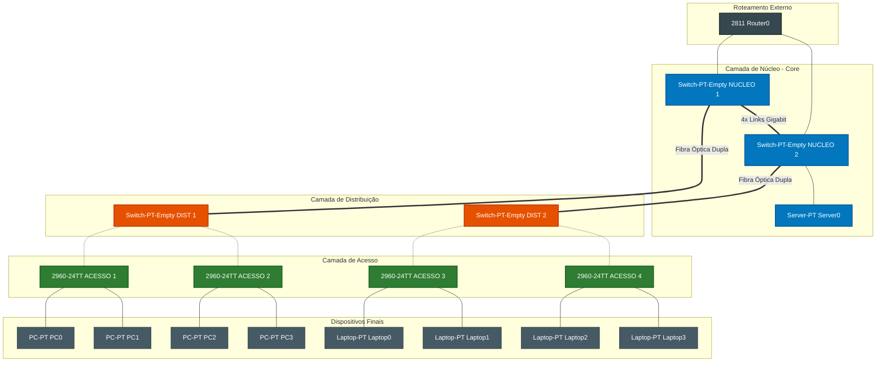

# 🏢 Simulação de Ambiente Hierárquico e Configuração de Switches Cisco


Projeto prático desenvolvido para a disciplina de **Comutação de Redes Locais**, contemplando a modelagem física de uma rede corporativa no modelo hierárquico de três camadas e a aplicação das diretrizes de configuração básica e segurança nos switches.

---

## 📌 Sumário
- [Topologia e Requisitos da Rede](#-topologia-e-requisitos-da-rede)
- [Diagrama da Arquitetura](#-diagrama-da-arquitetura)
- [Inventário dos Equipamentos](#-inventário-dos-equipamentos)
- [Parâmetros de Configuração dos Switches](#-parâmetros-de-configuração-dos-switches)
- [Scripts de Configuração Aplicados](#-scripts-de-configuração-aplicados)
- [Procedimentos de Teste e Validação](#-procedimentos-de-teste-e-validação)
- [Evidências de Funcionamento](#-evidências-de-funcionamento)

---

## 📐 Topologia e Requisitos da Rede

A infraestrutura foi projetada respeitando os requisitos técnicos da **Atividade 4**:
1. **Roteador**: Equipamento de borda com 2 interfaces FastEthernet, interligando-se a dois switches de núcleo distintos.
2. **Camada de Núcleo (Core)**: 
   - 2 switches de alta performance (`SW-CORE-01` e `SW-CORE-02`).
   - Conexão física entre si com 4 links GigabitEthernet preparados para futura agregação de **4 Gbps** (EtherChannel/LACP).
3. **Camada de Distribuição**:
   - 2 switches (`SW-DIST-01` e `SW-DIST-02`).
   - Conectados aos switches de núcleo por meio de cabos de fibra óptica com enlaces duplos preparados para agregação de **2 Gbps**.
4. **Camada de Borda (Acesso)**:
   - 4 switches (`SW-BORDA-01` a `SW-BORDA-04`) sem redundância de uplink.
5. **Dispositivos Finais**:
   - 4 computadores Desktop, 4 Notebooks e 1 Servidor, todos conectados via cabo nas portas de acesso dos switches de borda.

---

## 🗺️ Diagrama da Arquitetura



---

## 📋 Inventário dos Equipamentos

| Dispositivo | Camada | Modelo Sugerido | Enlaces / Conexões |
| :--- | :--- | :--- | :--- |
| **Roteador** | Roteamento | Cisco 2911 / 1941 | 2x FastEthernet para os switches de núcleo |
| **SW-CORE-01** | Núcleo | Catalyst 3560 / 2960 | 4x Gbps (inter-core) + 2x Fibra (Distribuição) |
| **SW-CORE-02** | Núcleo | Catalyst 3560 / 2960 | 4x Gbps (inter-core) + 2x Fibra (Distribuição) |
| **SW-DIST-01** | Distribuição | Catalyst 2960 / 3560 | 2x Fibra (Núcleo) + Portas 100BASE-T (Borda) |
| **SW-DIST-02** | Distribuição | Catalyst 2960 / 3560 | 2x Fibra (Núcleo) + Portas 100BASE-T (Borda) |
| **SW-BORDA-01** | Borda | Catalyst 2950-24 / 2960 | Uplink com SW-DIST-01 + Conexão a 2 Desktops |
| **SW-BORDA-02** | Borda | Catalyst 2950-24 / 2960 | Uplink com SW-DIST-01 + Conexão a 2 Notebooks |
| **SW-BORDA-03** | Borda | Catalyst 2950-24 / 2960 | Uplink com SW-DIST-02 + Conexão a 2 Desktops |
| **SW-BORDA-04** | Borda | Catalyst 2950-24 / 2960 | Uplink com SW-DIST-02 + Conexão a 2 Notebooks e Servidor |

---

## 🔒 Parâmetros de Configuração dos Switches

| Requisito | Comando Aplicado | Valor / Credencial | Finalidade |
| :--- | :--- | :--- | :--- |
| **Identificação** | `hostname` | `SW-[CAMADA]-[ID]` | Nome único na CLI |
| **Autenticação Console** | `line console 0`<br>`password`<br>`login` | `ifroredes` | Bloqueia acesso local não autorizado via cabo console |
| **Autenticação Privilegiada** | `enable secret` | `ifroredesenha` | Protege o acesso ao modo EXEC com hash criptográfico forte |
| **Criptografia de Senhas** | `service password-encryption` | Ativado | Converte senhas de texto puro do arquivo de configuração em cifra |
| **Banner Legal** | `banner motd #...#` | Mensagem Institucional | Aviso formal de acesso restrito |
| **Gravação na NVRAM** | `copy running-config startup-config` | Salvar | Persiste a configuração ativa contra quedas de energia |

---

## 💻 Scripts de Configuração Aplicados

### 1. Switches de Núcleo (`SW-CORE-01` e `SW-CORE-02`)
```ios
enable
configure terminal
hostname SW-CORE-01
enable secret ifroredesenha
service password-encryption
line console 0
 password ifroredes
 login
 exit
banner motd #
==============================================================
* ATENCAO: EQUIPAMENTO INSTITUCIONAL - IFRO CAMPUS ZONA NORTE *
*          CAMADA DE NUCLEO: SW-CORE-01 | ACESSO RESTRITO     *
==============================================================
#
end
copy running-config startup-config
```
*(Para o switch `SW-CORE-02`, substitua a linha do hostname e do banner).*

### 2. Switches de Distribuição (`SW-DIST-01` e `SW-DIST-02`)
```ios
enable
configure terminal
hostname SW-DIST-01
enable secret ifroredesenha
service password-encryption
line console 0
 password ifroredes
 login
 exit
banner motd #
==============================================================
* ATENCAO: EQUIPAMENTO INSTITUCIONAL - IFRO CAMPUS ZONA NORTE *
*       CAMADA DE DISTRIBUICAO: SW-DIST-01 | ACESSO RESTRITO  *
==============================================================
#
end
copy running-config startup-config
```

### 3. Switches de Borda (`SW-BORDA-01` a `SW-BORDA-04`)
```ios
enable
configure terminal
hostname SW-BORDA-01
enable secret ifroredesenha
service password-encryption
line console 0
 password ifroredes
 login
 exit
banner motd #
==============================================================
* ATENCAO: EQUIPAMENTO INSTITUCIONAL - IFRO CAMPUS ZONA NORTE *
*           CAMADA DE BORDA: SW-BORDA-01 | ACESSO RESTRITO    *
==============================================================
#
end
copy running-config startup-config
```

---

## 🔍 Procedimentos de Teste e Validação

Execute os seguintes comandos no modo privilegiado (`#`) para validar o ambiente:

1. `show running-config`: Verifica se as senhas estão criptografadas e as linhas protegidas.
2. `show startup-config`: Confirma se a configuração foi gravada na memória não volátil (NVRAM).
3. `show ip interface brief`: Exibe a tabela de portas físicas e confirma o status `up / up` das conexões ativas.
4. `show mac-address-table`: Mostra o aprendizado dinâmico de endereços MAC nas portas do switch.

---

## 📸 Evidências de Funcionamento

> *Substitua os arquivos na pasta `docs/` com as suas capturas de tela do Packet Tracer:*

### 1. Acesso ao Modo Privilegiado (`enable secret`)


### 2. Exibição do Banner e Autenticação de Console


### 3. Topologia Completa no Cisco Packet Tracer 

